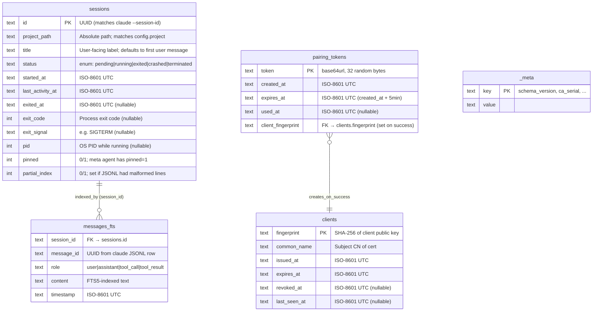
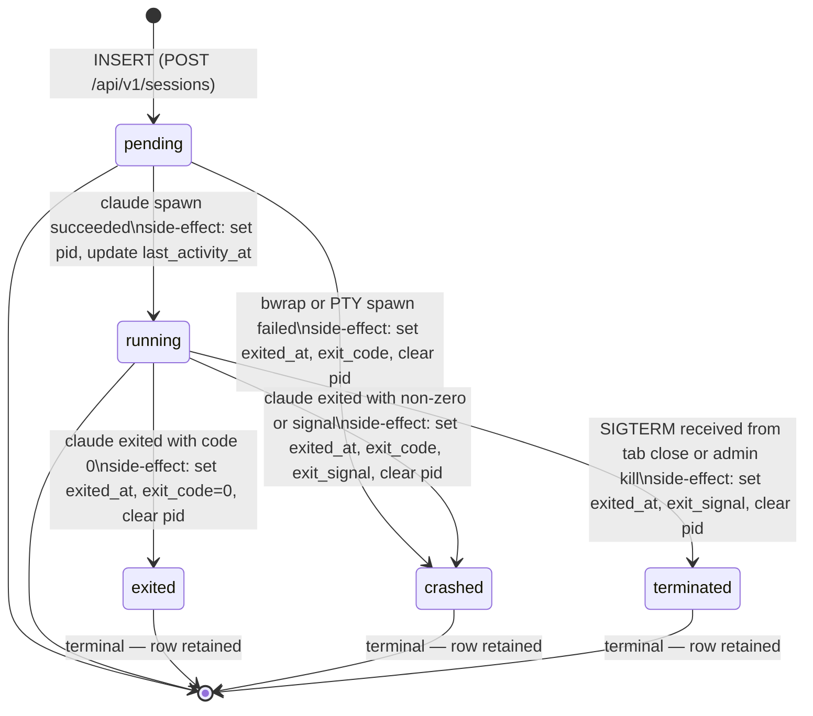
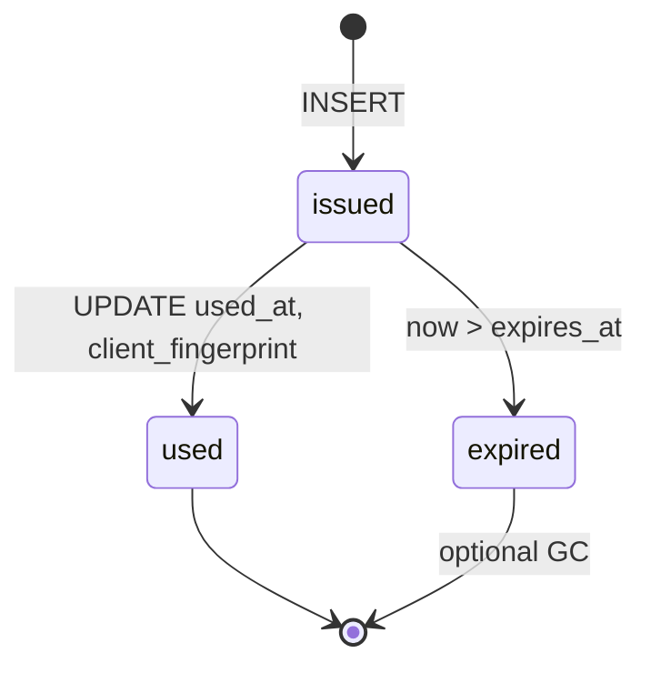

# Data Model — tabrunner 001-tabbed-pwa

## Overview

Single SQLite database at `<data_dir>/tabrunner.db` (WAL mode, single writer via in-process mutex). Schema versioned via `_meta.schema_version`, migrated forward-only on server start. The authoritative source for *message content* is claude's own JSONL files at `~/.claude/projects/<encoded-project>/<session-uuid>.jsonl`; the `messages_fts` table in our DB is a derived index.

## Entity-Relationship Diagram



## Tables

### `sessions`

```sql
CREATE TABLE sessions (
  id                TEXT PRIMARY KEY NOT NULL,
  project_path      TEXT NOT NULL,
  title             TEXT NOT NULL DEFAULT 'New session',
  status            TEXT NOT NULL CHECK (status IN ('pending','running','exited','crashed','terminated')),
  started_at        TEXT NOT NULL,
  last_activity_at  TEXT NOT NULL,
  exited_at         TEXT,
  exit_code         INTEGER,
  exit_signal       TEXT,
  pid               INTEGER,
  pinned            INTEGER NOT NULL DEFAULT 0 CHECK (pinned IN (0,1)),
  partial_index     INTEGER NOT NULL DEFAULT 0 CHECK (partial_index IN (0,1))
);

CREATE INDEX idx_sessions_status_started ON sessions(status, started_at DESC);
CREATE INDEX idx_sessions_project_started ON sessions(project_path, started_at DESC);
CREATE INDEX idx_sessions_pinned ON sessions(pinned) WHERE pinned = 1;
```

**Field constraints**:
- `id`: UUID v4 (string form, 36 chars). MUST match the `--session-id` passed to claude.
- `project_path`: absolute, normalized. MUST equal the value of `config.project` at the time the row was created. (Server only ever has one watched project per instance; this column exists for forward-compat with v2 multi-project.)
- `title`: free text; truncated to 200 chars on write.
- `status`: enforced by CHECK constraint. See [State Transitions](#session-state) below.
- Timestamps: ISO-8601 UTC with millisecond precision, e.g. `2026-05-24T14:23:11.456Z`. Stored as text for portability and human-readability.
- `pid`: NULL when not running; set on transition to `running`; cleared (`NULL`) on any terminal transition.
- `pinned`: only the meta agent's row is pinned=1.
- `partial_index`: set to 1 if the JSONL watcher encountered malformed lines for this session.

### `messages_fts` (FTS5 virtual table)

```sql
CREATE VIRTUAL TABLE messages_fts USING fts5(
  session_id     UNINDEXED,
  message_id     UNINDEXED,
  role           UNINDEXED,
  content,
  timestamp      UNINDEXED,
  tokenize = 'porter unicode61'
);
```

**Notes**:
- FTS5 with `porter unicode61` tokenizer for English stemming + Unicode normalization.
- Only `content` is indexed; other columns are stored verbatim.
- `message_id` uses claude JSONL row UUID where present; otherwise the SHA-256 of `(session_id, timestamp, role)` for deterministic upsert.
- Upsert pattern: `INSERT OR REPLACE INTO messages_fts ...` keyed by `(session_id, message_id)`.

### `clients`

```sql
CREATE TABLE clients (
  fingerprint    TEXT PRIMARY KEY NOT NULL,
  common_name    TEXT NOT NULL,
  issued_at      TEXT NOT NULL,
  expires_at     TEXT NOT NULL,
  revoked_at     TEXT,
  last_seen_at   TEXT
);

CREATE INDEX idx_clients_revoked ON clients(revoked_at) WHERE revoked_at IS NOT NULL;
CREATE INDEX idx_clients_expires ON clients(expires_at);
```

**Field constraints**:
- `fingerprint`: lowercase hex SHA-256 of the DER-encoded public key (or full cert; pick one and stick to it — we pick public key).
- `common_name`: subject CN of the issued cert; format `tabrunner-client-<short-fingerprint>`.

### `pairing_tokens`

```sql
CREATE TABLE pairing_tokens (
  token              TEXT PRIMARY KEY NOT NULL,
  created_at         TEXT NOT NULL,
  expires_at         TEXT NOT NULL,
  used_at            TEXT,
  client_fingerprint TEXT
);

CREATE INDEX idx_pairing_tokens_expires ON pairing_tokens(expires_at);
```

**Field constraints**:
- `token`: base64url-encoded 32 random bytes from `crypto.randomBytes(32)`. URL-safe, no padding.
- `expires_at`: always `created_at + 5 minutes`.
- `used_at`: NULL until the CSR is successfully signed.
- `client_fingerprint`: set when CSR succeeds; FK to `clients.fingerprint`.

### `_meta`

```sql
CREATE TABLE _meta (
  key    TEXT PRIMARY KEY NOT NULL,
  value  TEXT NOT NULL
);
```

**Required keys**:
- `schema_version` (integer as string): current migration version applied. Checked at startup; refuse to start if greater than what the server knows.
- `ca_next_serial` (integer as string): monotonic counter for cert serial numbers.
- `installed_at` (timestamp): when `tabrunner init` populated the database.

## State Transitions

### Session state (column: `sessions.status`)



**Notes**:
- Terminal states never transition back. To "reopen" a session, the operator creates a new attachment but the underlying `claude --resume <id>` keeps the same session row's id (no new row).
- Wait — important nuance: per FR-023, reopen calls `claude --resume <uuid>` in a fresh process. The session row's status flow on reopen:
  - If old row's status is terminal AND no PID alive → INSERT-OR-UPDATE: set `status='running'`, set new `pid`, leave `started_at` original.
  - If old row's status is `running` AND PID still alive → attach new WS client; no DB write.
- The `started_at` is the moment the session was *first* created. There's no concept of "re-started_at"; we treat each session id as one conversation thread regardless of how many process lifetimes it spans.

### Pairing token state (column-derived)



**Notes**: Expiration is implicit (compute `now > expires_at`); no explicit `expired` column. A periodic GC may delete rows where `expires_at < now - 1 day` to keep the table small.

### Client state (column-derived)

- **active**: `revoked_at IS NULL AND expires_at > now`
- **revoked**: `revoked_at IS NOT NULL`
- **expired**: `revoked_at IS NULL AND expires_at <= now`

The revocation set is also held in memory at the TLS layer for O(1) lookup on every handshake; the DB row is the durable source of truth and is checked on rare cache misses.

## Cross-entity constraints

1. **`sessions.pid` MUST be NULL when `status` is terminal.** Enforced by writes (no CHECK constraint because the rule is conditional on the enum value — write code must clear pid on terminal transitions).
2. **`pairing_tokens.client_fingerprint` MUST be non-NULL iff `pairing_tokens.used_at` is non-NULL.** Enforced by code; no FK because the order of writes is: insert client → update pairing token.
3. **`messages_fts` rows exist only for `sessions` rows that exist.** Soft FK (no FOREIGN KEY because FTS5 virtual tables don't support them). The JSONL watcher only writes rows for sessions whose JSONL files appear under the watched project.
4. **Two sessions MUST NOT share an `id`.** Enforced by PRIMARY KEY.
5. **The pinned meta session is created exactly once.** Enforced by code at server startup: SELECT pinned=1 LIMIT 1; if absent, INSERT a new row with a fresh UUID.

## Migrations

Numbered SQL files in `migrations/`:

```
migrations/
├── 001_init.sql      # All tables + indexes above
└── 002_*.sql         # Future
```

**Migration runner** (`src/db/migrate.ts`):
1. Open DB, enable WAL.
2. Create `_meta` if missing; read `schema_version` (default 0).
3. List `migrations/*.sql` in lex order.
4. For each file with version > current: BEGIN, exec, UPDATE `_meta.schema_version`, COMMIT.
5. On any error: roll back and exit 1 (do NOT leave DB partially migrated).
6. If `_meta.schema_version` > highest local migration → refuse to start (downgrade guard).

**Migration file format**:
```sql
-- 001_init.sql
CREATE TABLE sessions (...);
CREATE TABLE messages_fts (...);
-- etc.
```

No down migrations in v1 (forward-only).

## Storage estimates

| Entity | Row size (est) | 1-year volume (heavy user) | Total |
|--------|---------------|----------------------------|-------|
| `sessions` | ~500 bytes | 5000 sessions | ~2.5 MB |
| `messages_fts` (content) | ~200 bytes avg | 500K messages | ~100 MB |
| `messages_fts` index overhead | ~50% of content | — | ~50 MB |
| `clients` | ~300 bytes | 20 devices | ~6 KB |
| `pairing_tokens` (with GC) | ~150 bytes | 100 active at a time | ~15 KB |

**Total**: ~150 MB after a year of heavy daily use. SQLite handles this comfortably; backup is a single-file copy.

## Backup and restore

**Backup**: `cp -a <data_dir> <backup_location>` while server is stopped, OR `sqlite3 <db> '.backup <backup_location>/tabrunner.db'` online (no server stop).

**Restore**: stop server, replace `<data_dir>`, start server. Server runs migrations on start (idempotent for already-applied versions).

**Caveat (from FR-094)**: `<data_dir>/ca-key.pem` is included in the backup. Backups MUST be stored with the same protection as the CA itself.

## Data ownership boundaries

| Data | Owner | Storage | Tabrunner role |
|------|-------|---------|----------------|
| Session messages | Claude Code | `~/.claude/projects/<encoded>/<uuid>.jsonl` | Read-only consumer; FTS-indexed mirror |
| Session metadata (status, PID, timestamps, title) | tabrunner | `sessions` table | Sole writer |
| FTS index | tabrunner (derived) | `messages_fts` table | Sole writer; can be rebuilt from JSONL |
| Client certificates (public) | tabrunner | `clients` table + `<data_dir>/clients/<fp>.pem` | Sole writer |
| Client private keys | Each client (browser) | Browser keystore | Never on server |
| CA key | tabrunner | `<data_dir>/ca-key.pem` | Sole writer; chmod 600 |
| Pairing tokens | tabrunner | `pairing_tokens` table | Sole writer; one-shot |
| Operator's project files | Operator (project repo) | `<watched-project>/` | Read-only via meta agent's `read_project_file` |
| Configuration | Operator | `~/.config/tabrunner/config.toml` | Read-only |
| Audit log | tabrunner | pino stderr → journal | Append-only via logger |
