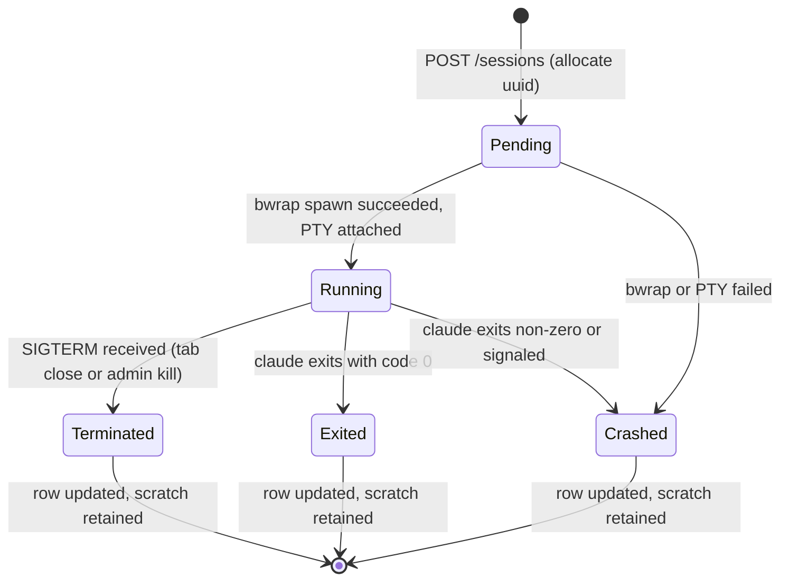
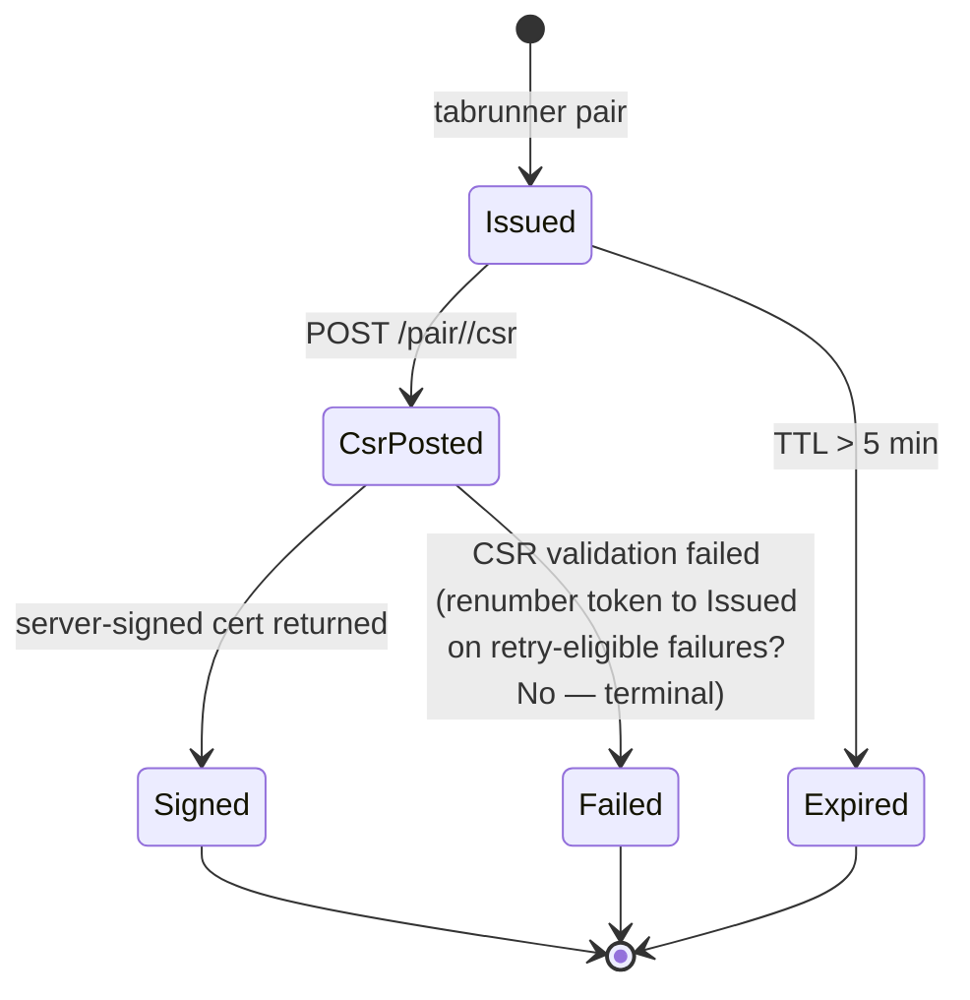
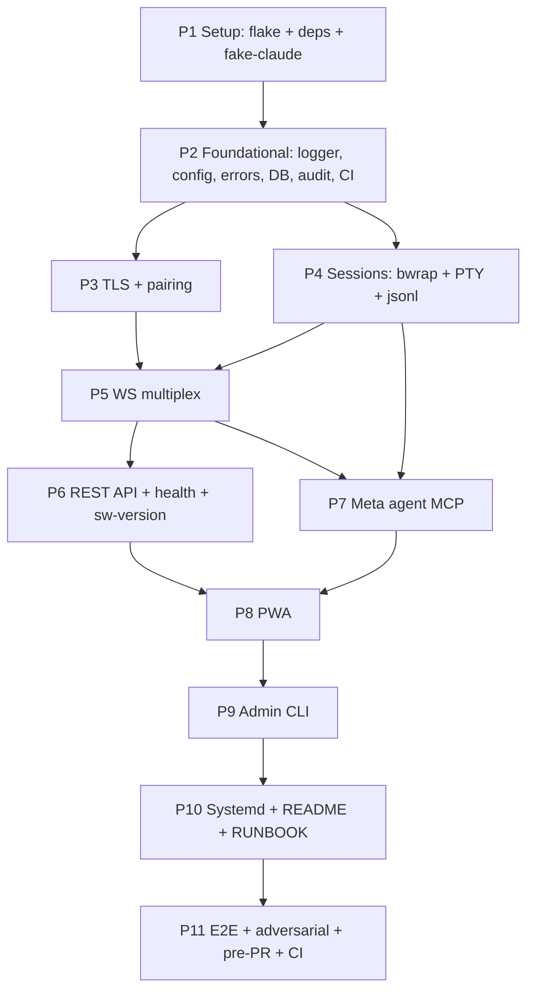

# Implementation Plan: tabrunner

**Branch**: `001-tabbed-pwa` | **Date**: 2026-05-24 | **Spec**: [spec.md](./spec.md)
**Input**: Feature specification from `specs/001-tabbed-pwa/spec.md`
**Constitution**: [.specify/memory/constitution.md](../../.specify/memory/constitution.md) v1.0.0
**Preset**: local (with mTLS-TOFU override per Constitution II)

## Summary

tabrunner is a Tailscale-bound TypeScript server and Preact PWA for managing parallel sandboxed `claude` CLI sessions in browser tabs, with a pinned read-only meta agent that exposes MCP tools over the SQLite history DB and live agent output. The technical approach is: Fastify + `@fastify/websocket` on Node 22, mTLS-TOFU via in-browser ECDSA P-256 keypair + server-signed CSR, per-session `claude` subprocesses inside bwrap sandboxes with PTY (node-pty), `better-sqlite3` for persistence + FTS5, a filesystem watcher over claude's session JSONL files for cross-session search, and `mcp-browser` headless Chromium for E2E.

## Technical Context

**Language/Version**: TypeScript 5.x, `"strict": true`, target ES2023, Node 22+
**Primary Dependencies**: fastify, @fastify/websocket, better-sqlite3, node-pty, pino, zod, chokidar, qrcode, preact, @preact/signals, esbuild, tsx
**Storage**: SQLite (single file `<data_dir>/tabrunner.db`, WAL mode) + `~/.claude/projects/<encoded>/<uuid>.jsonl` (read-only mirror, source of truth for messages)
**Testing**: `tsx --test` (native test runner), spec-kit structured reporter, `mcp-browser` for E2E
**Target Platform**: Linux x86_64 (bubblewrap, systemd, tailscale required)
**Project Type**: web-service + PWA (single Fastify server serves both API and static PWA assets)
**Performance Goals**: pair→first-message ≤60s; new-tab→first-token ≤3s; FTS lag ≤5s; PWA bundle ≤100KB gzip; 10 parallel sessions stable for 30min
**Constraints**: Single operator, Tailnet-only network, mTLS-enforced, Linux-only, no cloud telemetry
**Scale/Scope**: 1 watched project per server instance; 0–N concurrent sessions (no cap); typical history depth 100s–1000s of sessions over months

## Constitution Check

| Principle | Status | Notes |
|-----------|--------|-------|
| I. Single-User, Tailnet-Scoped | ✅ PASS | `tailscale ip -4` discovery, bind exclusively to that IP, fail-fast otherwise. FR-001/2. |
| II. mTLS-TOFU with QR Pairing | ✅ PASS | Self-signed CA, browser WebCrypto CSR, server-signed client cert, 5-min token TTL, 1-yr cert TTL. FR-005..015. |
| III. One Tab = One Sandboxed Claude Session | ✅ PASS | bwrap with same allowlist as parallel_runner.py, --unshare-pid, no credential mounts. FR-016/17. |
| IV. Single Source-of-Truth History DB | ✅ PASS | One SQLite file, per-tab scoped reads, meta reads all. FR-036..050. |
| V. TypeScript Strict, Tests Hit Reality | ✅ PASS | strict: true; integration tier uses real bwrap, real SQLite, real `claude` (or contract-compatible stub). FR-T1..T7. |
| VI. Meta Agent is Read-Only in v1 | ✅ PASS | MCP tool surface limited to queries; no spawn/kill/edit/shell. FR-051..065. |
| VII. Nix-First, No Global Installs | ✅ PASS | flake.nix is canonical; --ignore-scripts on npm; specify via uvx; claude pinned in flake. FR-089, FR-091. |

**Result**: All seven principles satisfied. **No Complexity Tracking entries required.**

## Project Structure

### Documentation (this feature)

```
specs/001-tabbed-pwa/
├── spec.md              # Feature spec
├── plan.md              # This file
├── research.md          # Architecture decisions + rejected alternatives
├── data-model.md        # SQLite schema + entity relationships + state transitions
├── quickstart.md        # 10-minute setup walkthrough
├── workflows.md         # Phase 5.5 — persona-driven E2E test contract
├── contracts/
│   ├── http.md          # REST endpoint shapes
│   ├── ws.md            # WebSocket envelope + event types
│   ├── mcp.md           # tabrunner MCP server tool schemas
│   └── interface.md     # Internal interface contracts (IC-001..N)
├── interview-notes.md   # Already exists
└── tasks.md             # Generated by Phase 6
```

### Source code (repo root: `skills/spec-kit/runner-ts/`)

```
src/
├── server.ts                    # Entry point: tabrunner CLI (init|serve|pair|sessions|clients)
├── cli/
│   ├── init.ts                  # `tabrunner init` interactive setup
│   ├── serve.ts                 # `tabrunner serve` wrapper around src/app.ts
│   ├── pair.ts                  # `tabrunner pair` QR generation
│   ├── sessions.ts              # `tabrunner sessions list|kill`
│   └── clients.ts               # `tabrunner clients list|revoke`
├── app.ts                       # Fastify app factory
├── config/
│   ├── load.ts                  # TOML loader + zod validation + env overrides
│   └── claude-version.ts        # Expected claude major.minor constant; startup version check
├── tls/
│   ├── ca.ts                    # CA gen + cert signing
│   ├── server-cert.ts           # Server cert gen/rotation
│   ├── pairing.ts               # Token issue + CSR sign
│   └── revocation.ts            # In-memory + DB revocation set
├── tailscale/
│   └── discover.ts              # `tailscale ip -4` shell-out
├── db/
│   ├── index.ts                 # better-sqlite3 connection + WAL + write mutex
│   ├── migrate.ts               # Migration runner (forward-only)
│   ├── migrations/              # 001_init.sql, 002_..., numbered SQL files
│   └── repo/
│       ├── sessions.ts
│       ├── messages-fts.ts
│       ├── clients.ts
│       ├── pairing-tokens.ts
│       └── audit.ts
├── claude/
│   ├── spawn.ts                 # bwrap + node-pty spawn wrapper
│   ├── session.ts               # Per-session orchestrator (PTY stdin/stdout, lifecycle, status)
│   ├── jsonl-parser.ts          # Parse claude session jsonl rows → typed messages
│   ├── jsonl-watcher.ts         # chokidar watcher over ~/.claude/projects/<encoded>/
│   └── encoded-path.ts          # Convert /home/max/git/foo → -home-max-git-foo
├── ws/
│   ├── server.ts                # @fastify/websocket setup
│   ├── envelope.ts              # zod schemas for the typed envelope
│   ├── multiplexer.ts           # Map session_id → subscriber set; sequence numbering
│   └── buffer.ts                # 60s replay buffer per session
├── api/
│   ├── routes.ts                # Register all REST routes
│   ├── sessions.ts              # GET/POST /api/v1/sessions/*
│   ├── pair.ts                  # POST /pair/<token>/csr (no client cert required here)
│   ├── health.ts                # /api/v1/health, /ready, /sw-version
│   └── errors.ts                # Error → HTTP mapper
├── meta-agent/
│   ├── mcp-server.ts            # stdio MCP server exposing the read-only tools
│   ├── tools.ts                 # Tool implementations (query_sessions, etc.)
│   └── path-guard.ts            # Path-traversal-safe project file access
├── security/
│   ├── headers.ts               # Fastify plugin injecting FR-097 headers
│   └── audit-log.ts             # Structured audit channel via pino
├── pwa/
│   ├── ui/                      # Preact components
│   │   ├── App.tsx
│   │   ├── TabBar.tsx
│   │   ├── Tab.tsx
│   │   ├── Composer.tsx
│   │   ├── Message.tsx          # Chat-bubble renderer; tool-call collapse
│   │   ├── MetaTab.tsx
│   │   ├── HistoryView.tsx
│   │   └── PairingPage.tsx
│   ├── state/
│   │   ├── signals.ts           # Preact signals for tabs, sessions, connection
│   │   └── ws-client.ts         # WS connect + envelope decoder + reconnect logic
│   ├── pairing/
│   │   └── webcrypto.ts         # ECDSA P-256 keygen + CSR build + cert install
│   ├── sw.ts                    # Service worker (asset cache + SW version polling)
│   └── index.html
├── lib/
│   ├── errors.ts                # AppError hierarchy
│   ├── logger.ts                # pino factory + correlation ID helpers
│   └── time.ts                  # ISO-8601 UTC helpers
└── types/
    └── shared.ts                # Types shared between server + PWA

tests/
├── unit/
│   ├── config/
│   ├── tls/
│   ├── ws/
│   ├── claude/
│   └── meta-agent/
├── integration/
│   ├── tls-handshake.test.ts    # Real test CA + real client cert
│   ├── session-lifecycle.test.ts # Real bwrap + real fake-claude
│   ├── jsonl-watcher.test.ts    # Real chokidar watching test jsonl files
│   ├── ws-replay.test.ts        # Disconnect+reconnect buffer flow
│   ├── pairing-end-to-end.test.ts
│   ├── meta-tools.test.ts       # MCP tool calls against a populated test DB
│   └── server-restart.test.ts   # SIGTERM + graceful shutdown
├── contract/
│   ├── ws-envelope.test.ts      # Validate every WS event type against zod
│   ├── http-shapes.test.ts      # Endpoint shape contract checks
│   ├── mcp-tools.test.ts        # MCP input/output schema validation
│   └── interface.test.ts        # IC-001..N contract verification
├── e2e/
│   ├── README.md
│   ├── setup.sh                 # Spin up a test server with test CA; write env to .state
│   ├── teardown.sh
│   ├── pair-flow.test.ts        # US-1
│   ├── single-tab.test.ts       # US-2
│   ├── multi-tab.test.ts        # US-3
│   ├── reopen-from-history.test.ts # US-4
│   ├── meta-query.test.ts       # US-5
│   ├── search-sessions.test.ts  # US-6
│   ├── admin-revoke.test.ts     # US-7
│   ├── server-restart.test.ts   # US-8
│   └── adversarial-cert.test.ts # Expired / wrong-CA / no-cert rejection
└── helpers/
    ├── fake-claude.ts           # Stub binary mimicking claude's stdin/stdout/jsonl contract
    ├── test-ca.ts               # Test CA + client/server cert factory
    ├── test-db.ts               # Per-test SQLite file
    ├── test-reporter.ts         # spec-kit structured reporter
    └── ws-test-client.ts        # WS test client with mTLS

migrations/
├── 001_init.sql                 # sessions, messages_fts, clients, pairing_tokens, _meta
└── ...                          # Future migrations

data/                            # gitignored; created by `tabrunner init`
├── ca.pem
├── ca-key.pem
├── server-cert.pem
├── server-key.pem
├── tabrunner.db                 # Default at <data_dir>/tabrunner.db; data/ is a symlink in dev
└── sessions/<uuid>/             # Per-session scratch directories

etc/systemd/
└── tabrunner.service            # User-unit template

public/                          # esbuild output (gitignored except manifest.webmanifest + icons)
├── index.html
├── app.js
├── sw.js
├── app.css
├── manifest.webmanifest         # checked in
└── icons/                       # checked in

scripts/
├── dev-full.sh                  # Start everything for dev
└── gen-fake-claude.sh           # Build the stub claude binary
```

**Single project structure**. Server + PWA share the repo; PWA is bundled to `public/` and served by the same Fastify instance over mTLS.

## Architecture decisions (summary — full in [research.md](./research.md))

### Stack

| Concern | Choice | Why |
|---------|--------|-----|
| Language/runtime | TypeScript strict on Node 22 | Constitution V; Node 22 is current LTS with stable `node:test`, `crypto.randomUUID`, `Promise.withResolvers` |
| Package manager | npm with `--ignore-scripts` + selective `npm rebuild` | Built into Node; lockfile committed; `--ignore-scripts` blocks postinstall attacks |
| Bundler (PWA) | esbuild | Fast (sub-second), JSX support, no config sprawl |
| Server framework | Fastify + @fastify/websocket | Built-in JSON schema validation, native mTLS via Node https, plugin pattern fits our cross-cutting concerns (auth, security headers, audit log) |
| HTTP framework alts rejected | Hono (less plugin maturity for mTLS+WS), node:http (more code for no benefit) | See research.md |
| WebSocket library | @fastify/websocket | Tight integration; underlying `ws` library is battle-tested |
| Database | SQLite via better-sqlite3 | Per Constitution IV; better-sqlite3 is synchronous (simpler concurrency), faster than node-sqlite3 |
| Migration runner | Hand-rolled (numbered SQL files) | Constitution VII (no extra deps for small surface); spec-kit's pattern |
| FTS | SQLite FTS5 virtual table | Built into SQLite; no extra dep; well-suited to message text |
| Filesystem watcher | chokidar | Reliable on Linux; mature; debouncing built-in |
| PTY | node-pty | The de-facto choice; requires `npm rebuild` for native bits |
| Subprocess sandbox | bubblewrap (bwrap) | Per Constitution III; matches parallel_runner.py allowlist |
| QR code generation | qrcode | Tiny, sync API for the CLI use case |
| Schema validation | zod | TS-native, runtime + compile-time |
| Logging | pino + pino-pretty (dev) | Per interview; fastest Node logger; correlation-friendly |
| PWA framework | Preact + @preact/signals | Per interview; 3KB; signals match streaming WS state model |
| PWA styling | Hand-rolled CSS (no framework) | Bundle ≤100KB cap; small surface |
| PWA state | Signals (no Redux/Zustand) | Sufficient for tab/session/connection state |
| Test runner | Native `node:test` via tsx | Built-in; no Jest/Vitest overhead; fast |
| E2E driver | mcp-browser from nix-mcp-debugkit | Per spec-kit pattern; agents explore the PWA via MCP tools |
| Coverage | `c8` | Standard Node coverage; integrates with `node:test` |
| Linter | eslint + @typescript-eslint | Standard; strict rules in `eslint.config.js` |
| Formatter | prettier | Standard; pre-commit hook |
| Process supervisor | systemd user unit | Per interview; reliable, journal logs out of the box |
| Tailscale IP discovery | `tailscale ip -4` shell-out | Per interview; no API token needed |

### Tool environment inventory

| Command | Tool | Nix package | Notes |
|---------|------|-------------|-------|
| `node`, `npm` | Node.js 22 | `nodejs_22` | nixpkgs unstable |
| `tsx` | TypeScript runner | npm (via `npm install`) | Dev dep |
| `tsc` | TypeScript compiler | `typescript` | Top-level nixpkgs (NOT `nodePackages.typescript`) |
| `esbuild` | Bundler | npm + `npm rebuild esbuild` (native) | Postinstall via rebuild |
| `claude` | Claude Code CLI | Custom derivation in flake (pinned SHA) | Must match `TABRUNNER_EXPECTED_CLAUDE_MAJOR_MINOR` |
| `bwrap` | bubblewrap | `bubblewrap` | nixpkgs |
| `tailscale` | Tailscale CLI | `tailscale` | nixpkgs; needs `tailscaled` running (host service) |
| `sqlite3` | SQLite CLI (debug) | `sqlite` | nixpkgs |
| `openssl` | Cert ops fallback | `openssl` | We use Node crypto primarily; openssl available for debug |
| `specify` | spec-kit CLI | `uvx --from git+...` ephemeral | Per Phase 0 install rule |
| `code-review-graph` | Knowledge graph | `crg` from skill flake | Already wired in Phase 0 |
| `mcp-browser` | Headless Chromium MCP | `nix-mcp-debugkit` flake input | Add in Phase 1 |
| `gh` | GitHub CLI (CI access) | `gh` | nixpkgs |
| `jq` | JSON wrangler | `jq` | nixpkgs |

**Risk: claude CLI Nix derivation.** Claude Code may not have a clean nix derivation. Plan task T-002 covers this: try `nix-shell -p claude-code` first; if that doesn't exist or has the wrong version, write a derivation that fetches the pinned npm tarball or GitHub release. Update `flake.nix` accordingly.

### Runtime state machines

**Per-session state** (each running `claude` subprocess):



Transitions emit `session.status` WS events. Edge cases for each state are enumerated in spec.md "Edge Cases & Failure Modes".

**Pairing state** (per pairing token):



**Server lifecycle**:

```mermaid
stateDiagram-v2
    [*] --> Starting: tabrunner serve
    Starting --> AcceptingPair: TLS+mTLS ready; mTLS accepts /pair/*
    Starting --> Failed: config/data/CA/DB missing OR tailscale down OR claude version mismatch
    AcceptingPair --> Ready: FTS initial scan done
    Ready --> Draining: SIGTERM
    Draining --> Stopped: All sessions SIGTERMed (10s grace) and SIGKILLed; DB flushed
    Failed --> [*]
    Stopped --> [*]
```



`/ready` returns 200 only in the `Ready` state.

### Loading/initialization states (PWA)

| Phase | UI state | What user sees |
|-------|----------|----------------|
| Unpaired | `<PairingPage />` | "Device not paired. Run `tabrunner pair` and scan the QR." |
| Pairing CSR submitted | `<PairingPage>` loading state | "Generating keypair…" → "Awaiting server signature…" |
| Cert installed, connecting WS | `<App>` with `connection: "connecting"` signal | "Connecting to tabrunner…" banner |
| Connected, fetching state | `<App>` with `connection: "syncing"` | "Syncing sessions…" |
| Fully ready | Full UI | Tab bar, composer enabled |
| WS dropped | `<App>` with `connection: "reconnecting"` banner | "Reconnecting…" + last seq cursor displayed in dev mode |

## Interface contracts (internal)

| IC | Name | Producer | Consumer(s) | Specification |
|----|------|----------|-------------|---------------|
| IC-001 | Config file shape | `tabrunner init` (writes TOML) | `src/config/load.ts` (reads TOML) | Path: `~/.config/tabrunner/config.toml`; format: TOML; fields: `project: string` (abs path, required), `port: int` (default 8443), `tailscale_interface: string` (default empty = auto-discover), `data_dir: string` (default `~/.local/share/tabrunner`); validation: zod schema, fail-fast |
| IC-002 | CA + cert files | `tls/ca.ts`, `tls/server-cert.ts` | `tls/server-cert.ts` (consumes ca-key), Fastify TLS opts | Paths: `<data_dir>/ca.pem`, `<data_dir>/ca-key.pem`, `<data_dir>/server-cert.pem`, `<data_dir>/server-key.pem`; format: PEM; perms: ca-key 0600, others 0644; lifecycle: created by `init`, server cert auto-rotated within 30d of expiry |
| IC-003 | Pairing token | `tls/pairing.ts` (issuer) | `api/pair.ts` (verifier) | Format: URL `/pair/<base64url-32-bytes>`; storage: `pairing_tokens` table; TTL: 5 min; one-shot |
| IC-004 | Client cert | `tls/pairing.ts` (signer) | TLS layer (verifier on every handshake) + `clients` table (registry) | Format: PEM X.509 ECDSA P-256; subject CN = SHA-256(public key); validity: 365 days; revocation via `clients.revoked_at IS NOT NULL` + in-memory set |
| IC-005 | Session DB row | `claude/session.ts` (writer) | `api/sessions.ts`, `meta-agent/tools.ts` (readers) | Table: `sessions`; columns per FR-038; primary key: `id` (UUID); status enum: pending|running|exited|crashed|terminated |
| IC-006 | FTS row | `claude/jsonl-watcher.ts` (writer) | `meta-agent/tools.ts:search_messages` (reader) | Table: `messages_fts` (FTS5); columns: session_id, message_id, role, content (indexed), timestamp |
| IC-007 | WS envelope | `ws/multiplexer.ts` (server emitter) | `pwa/state/ws-client.ts` (consumer) | Shape: `{type: string, session_id: string|null, seq: number, payload: object}`; types enumerated in contracts/ws.md; serialized as JSON |
| IC-008 | claude jsonl session file | claude CLI (writer, external) | `claude/jsonl-parser.ts` (reader) | Path: `~/.claude/projects/<encoded-project-path>/<session-uuid>.jsonl`; format: newline-delimited JSON; schema: rows have `{type: string, timestamp: ISO-8601, sessionId: UUID, ...}` — UNSTABLE upstream; pinned via FR-091 claude version check |
| IC-009 | bwrap profile | `claude/spawn.ts` (writer) | bwrap process (consumer) | Arg vector: `--unshare-pid --ro-bind /nix /nix --ro-bind /etc/resolv.conf /etc/resolv.conf --bind <project_path> <project_path> --bind <scratch_dir> <scratch_dir> --dev /dev --proc /proc --setenv HOME <scratch>/home --setenv PATH /nix/store/...:/run/current-system/sw/bin --setenv CLAUDE_CODE_OAUTH_TOKEN <env passthrough>`; DNS allowlist enforced via filter (see Security section) |
| IC-010 | MCP tool I/O | `meta-agent/tools.ts` (implementer) | meta agent claude session (consumer via stdio MCP) | Schemas per contracts/mcp.md; stdio JSON-RPC; tool list registered at server start |
| IC-011 | Audit log line | `security/audit-log.ts` (writer) | pino sink (stderr/journal) (consumer) | Format: pino JSON with `{audit_id: uuid, channel: "audit", actor: "meta-agent"\|"admin-cli"\|"pwa", tool?: string, args?: object, outcome: "ok"\|"deny"\|"error", reason?: string}` |
| IC-012 | claude version expected constant | build constant in `src/config/claude-version.ts` | `src/cli/serve.ts` startup check | Constant: `EXPECTED_CLAUDE_MAJOR_MINOR = "1.0"` (current target); compared to parsed `claude --version` major.minor |
| IC-013 | systemd unit template | `etc/systemd/tabrunner.service` (writer: repo) | `~/.config/systemd/user/tabrunner.service` (consumer: systemctl) | INI; references `tabrunner serve`; user unit; Restart=always; Type=exec |

## Testing strategy

### Test tiers

- **Unit** (`tests/unit/`): pure-function logic. cert subject CN derivation, config schema validation, FTS query builder, encoded-project-path conversion, message parser, WS envelope codec, path-traversal guard. Target: <10s total. Mocks allowed for inputs but no I/O.
- **Integration** (`tests/integration/`): real SQLite file (one per test), real bwrap, real `fake-claude` binary (built by `scripts/gen-fake-claude.sh`). Target: <2min. **No mocks at this layer.**
- **Contract** (`tests/contract/`): every WS event type validated against its zod schema; every REST endpoint validated against its OpenAPI-like contract doc; every MCP tool's input/output validated against `contracts/mcp.md`. Target: <30s.
- **E2E** (`tests/e2e/`): `mcp-browser` headless Chromium drives the real PWA. Real test server with test CA. Fake-claude binary in bwrap. Per-story scenarios from spec.md US-1..US-8 plus adversarial cert rejection. Target: <10min. Follows spec-kit explore-fix-verify per `reference/mcp-e2e-web.md`.

### User-flow integration test plan

For each US-x, the boundary chain + injectable seam + observable output:

| Flow | Boundaries crossed | Injectable seam | Observable output |
|------|-------------------|-----------------|-------------------|
| US-1 Pair | CLI → server (TLS bootstrap) → pairing token DB → browser CSR endpoint → cert sign → cert delivery → next handshake | Pairing token (fixture); browser keypair (test-only deterministic seed) | Client cert PEM exists; subsequent `https://...:8443/api/v1/health` with client cert returns 200 |
| US-2 Single tab | PWA → WS → multiplexer → claude/session → bwrap → fake-claude → jsonl-watcher → FTS → WS back | Fake-claude script (echoes a known message); test project dir | `messages_fts` has the expected row; WS test client receives `session.message` event with content |
| US-3 Multi-tab | Same as US-2 × N | N test sessions, each with distinct content | N independent jsonl files; N independent WS event streams |
| US-4 Reopen | History API → sessions table → spawn with `--resume <uuid>` | Closed session row + jsonl file | New PID for resumed session; WS clients see replayed messages then live events |
| US-5 Meta query | Meta tab → tabrunner MCP server → tools.ts → DB+PID registry | Pre-populated test DB with sessions in various states | MCP tool call returns expected JSON matching `contracts/mcp.md` schema |
| US-6 Search | PWA history search → /api/v1/sessions?search → FTS5 query | Test DB with seeded messages | Response has matching snippet + session metadata |
| US-7 Admin revoke | CLI revoke → DB write → revocation set update → TLS handshake check | Paired client cert | First handshake after revoke fails at TLS layer (recorded in test log) |
| US-8 Server restart | SIGTERM → shutdown handler → child SIGTERM → SIGKILL grace → exit | Running test server with N sessions | All N PIDs exit within 10s; DB flushed; new `serve` reopens sessions via `--resume` |
| Adversarial | Connect attempts with: expired client cert, wrong-CA cert, no cert, revoked cert | Adversarial cert fixtures from `tests/helpers/test-ca.ts` | All four rejected at TLS handshake; nothing reaches application logic |

### Real-runtime E2E

- **Runtime**: `mcp-browser` from `nix-mcp-debugkit`. Headless Chromium on Linux. Always on (no platform gating).
- **Backend setup**: `tests/e2e/setup.sh` starts the test server (binds to 127.0.0.1 for E2E only — this is the ONE exception to Principle I, scoped to test env via `TABRUNNER_E2E_TEST=1` env var; production code path forbids non-Tailscale binds at startup with the check disabled only when this env var is set). Writes connection info (host, port, test CA path, test pairing token) to `tests/e2e/.state/env`.
- **Teardown**: `teardown.sh` sends SIGTERM to the test server, removes `.state/`.
- **App build + install contract**: `npm run build` produces `public/` + `dist/`; `npm run start` runs `dist/server.js`. The runner invokes both before each E2E iteration.
- **Scripted regression harness**: in addition to MCP exploration, the per-story scenarios in `tests/e2e/*.test.ts` are Playwright-driven scripted regressions (Playwright is added as a dev dep). The MCP exploration phase finds bugs; the Playwright regression phase ensures fixed bugs stay fixed.
- **Permission allowlist for `.claude/settings.local.json`**: `Bash(nix run .#mcp-browser:*)`, `Bash(npm run build:*)`, `Bash(npm run start:*)`, `Bash(tests/e2e/setup.sh:*)`, `Bash(tests/e2e/teardown.sh:*)`, `Bash(tabrunner *:*)`.

### Adversarial security tests

| Boundary | Adversarial fixture | Expected behavior |
|----------|---------------------|-------------------|
| mTLS (FR-005) | No client cert | TCP-level reject; no app handler runs |
| mTLS | Wrong-CA client cert | TLS handshake fails; no app handler runs |
| mTLS | Expired client cert | TLS handshake fails; no app handler runs |
| mTLS | Revoked client cert | TLS handshake fails on first attempt after revoke (within 5s SLA) |
| /pair (FR-008) | Pairing token used twice | First succeeds; second returns 410 Gone |
| /pair | Expired pairing token | 410 Gone |
| MCP path guard (FR-059) | `read_project_file("../../etc/passwd")` | 403 with audit log entry |
| MCP path guard | `read_project_file("/etc/passwd")` (absolute outside project) | 403 with audit log entry |
| MCP path guard | symlink within project pointing outside | 403 (server resolves real path before check) |

### Pre-PR gate (`make pre-pr`)

Single command that runs (in order, fail-fast):

1. `npm run typecheck`
2. `npm run lint`
3. `npm run test:unit`
4. `npm run test:contract`
5. `npm run test:integration`
6. `npm run build` (succeed = the artifact builds)
7. `npm run test:e2e` (Playwright regression — MCP exploration is separate, runner-driven)
8. Security scan: `trivy fs .`, `semgrep --config auto src/`, `gitleaks detect`, `npm audit --audit-level=high`
9. CI workflow file validation: `gh workflow list` confirms `.github/workflows/ci.yml` parses

### Test plan matrix (SC → test mapping)

| SC | Test tier | Fixture | Assertion | Infra |
|----|-----------|---------|-----------|-------|
| SC-001 (pair → first message ≤60s) | E2E | Test CA, test pairing QR, mobile-emulation Chromium | Time(pair complete → first WS message) < 60s | mcp-browser |
| SC-002 (new-tab → first-token ≤3s) | E2E | Fake-claude with 100ms first-byte | Time(POST /sessions → first session.message event) < 3s | mcp-browser |
| SC-003 (PWA bundle ≤100KB gzip) | Build | (none) | gzip-size of `public/app.js + app.css` < 100KB | esbuild + size-limit |
| SC-004 (10 sessions × 30min, no PID leaks) | Integration soak | 10 fake-claude in parallel | PID count stable; `tabrunner sessions kill --all` returns count 0 | Real bwrap |
| SC-005 (WS reconnect resumes <1s) | Integration | WS test client, force disconnect | Time(reconnect → first replayed event) < 1s | Test server |
| SC-006 (FTS lag ≤5s) | Integration | Write to fake jsonl | Time(write → search_messages returns row) < 5s | chokidar + test FTS |
| SC-007 (cold startup ≤2s) | Integration | Existing DB | Time(spawn → /ready 200) < 2s | Test server |
| SC-008 (zero critical vulns) | CI | (none) | Trivy + Semgrep + Gitleaks + npm audit exit 0 | GitHub Actions |
| SC-009 (US-1..8 pass) | E2E | (per story) | Each `tests/e2e/<us>.test.ts` exits 0 | mcp-browser + Playwright |
| SC-010 (tail_live p95 ≤200ms) | Integration | Session with 10K stdout lines | p95 over 100 calls < 200ms | Bench harness |
| SC-011 (path traversal 403 + audit) | Contract+E2E | (none) | 403 returned; audit log entry present | Real audit log |
| SC-012 (revoked cert rejected ≤5s) | Integration | Paired client + revoke | Time(revoke command → handshake fails) < 5s | Real TLS |
| SC-013 (claude version mismatch → exit 78 ≤1s) | Integration | Fake claude with wrong version string | Exit code 78 in <1s | Wrapper script |
| SC-014 (`tabrunner init` ≤10s clean env) | Integration | Empty data_dir/config | Init completes <10s; subsequent serve listens <2s | Real CLI |
| SC-015 (tool-call expand <100ms) | E2E | PWA with seeded tool calls | Click → expanded DOM <100ms | mcp-browser timing |
| SC-016 (Cmd/Ctrl+Enter sends, no newline) | E2E (mobile emulation) | iOS Safari emulation | Composer state empty after Cmd+Enter | mcp-browser |
| SC-017 (security headers present) | Contract | Authenticated GET / | All 5 headers present | Test server |
| SC-018 (`/ready` 503→200 in 5s on 100 sessions) | Integration | Test DB with 100 sessions | Initial scan + /ready 200 within 5s of /ready first 503 | Real FTS |
| SC-019 (PWA SW update prompt ≤60s) | E2E | Bump build version mid-test | Update prompt appears within 60s of navigation | mcp-browser |

### Fix-validate loop

Per `reference/testing.md`: every phase ends with `npm run test:<tier>`. Failures produce a structured `test-logs/<phase>-<run>.jsonl` parseable by the runner. The fix agent reads the failure rows, identifies root cause, fixes, and re-runs until clean.

## E2E scenario pre-registration

Going through the 13-category checklist from `phases/plan.md`:

1. **Happy path per user role**: Single role (operator). Covered by US-1..US-5.
2. **Every state machine**: Session state machine — all transitions covered by US-2, US-3, US-4, US-8, plus crashed fake-claude in US-2 variant.
3. **Every external adapter**: No external adapters in v1. Tailscale is read-only at startup; claude is a stubbed subprocess.
4. **Every webhook**: N/A (no webhooks).
5. **Every spec edge case**: Adversarial cert tests cover TLS edges; jsonl partial-write covered in integration; disk-full and DB-corruption are deferred to manual ops verification (no automated test for v1).
6. **Cross-app real-time propagation**: Multi-tab WS subscription (one operator viewing a session from two browsers) — covered by `tests/integration/ws-replay.test.ts` and `tests/e2e/multi-tab.test.ts` variant.
7. **Guest → authenticated linking**: N/A (no guest mode; mTLS required everywhere).
8. **Every refund / cancellation / reversal**: N/A (no payments).
9. **Every notification delivery**: N/A (no notifications in v1).
10. **Every rate/race**: WS reconnect race (US-8); concurrent FTS write (covered in integration); two devices race pair token (covered in spec edge cases — `tests/integration/pairing-end-to-end.test.ts` variant).
11. **Security boundary sweep**: Adversarial cert tests + path-traversal guard tests.
12. **Upload / file picker**: N/A (no file upload in v1).
13. **Cross-platform parity**: PWA on desktop Chromium AND mobile-emulation Chromium — covered in E2E (US-2 + US-3 variants).

**All 13 categories explicitly addressed. No silent skips.**

## Critical path (day-1 user flow)

The walking skeleton:

1. Operator runs `tabrunner init` → config + CA + DB created → exits.
2. Operator runs `tabrunner serve` → server binds to Tailscale IP, listens.
3. Operator runs `tabrunner pair` → QR + URL printed.
4. On phone, operator opens URL → browser does mTLS handshake fallback (no cert yet — `/pair/*` is the one exception) → pairing page loads → WebCrypto keygen → CSR posted → server returns signed cert → cert installed → redirect to `/`.
5. PWA loads → mTLS handshake succeeds with installed cert → WS connects → operator sees empty tab bar with pinned Meta tab.
6. Operator clicks New Tab → POST `/api/v1/sessions` → server allocates UUID → spawns bwrap+claude → PWA tab opens → WS receives `session.created` then `session.stdout`/`session.message`.
7. Operator types "hello" → composer sends `session.input` over WS → server writes to PTY → claude responds → WS receives `session.message` events → chat bubbles render.

**Phase mapping**:
- Phase 1 (Setup) → flake.nix, npm dependencies, code-review-graph wired, fake-claude built.
- Phase 2 (Foundational) → logger, config, error hierarchy, DB+migrations, audit log, CI/CD pipeline.
- Phase 3 (TLS+pairing) → CA gen, server cert, pairing flow. **Checkpoint: `curl` with paired cert returns 200 from `/api/v1/health`.**
- Phase 4 (Sessions) → bwrap spawn, PTY, jsonl parser, jsonl watcher, FTS. **Checkpoint: integration test starts fake-claude, sees `session.message` events.**
- Phase 5 (WS multiplex) → envelope, multiplexer, replay buffer. **Checkpoint: WS client receives streamed events; reconnect resumes.**
- Phase 6 (REST API) → sessions, history, health, sw-version. **Checkpoint: history search returns FTS5 hits.**
- Phase 7 (Meta agent MCP) → mcp-server stdio, tools, path guard. **Checkpoint: meta tab queries via MCP.**
- Phase 8 (PWA) → Preact app, pairing page, tab bar, composer, history, meta tab. **Checkpoint: full day-1 flow works end-to-end in mcp-browser.**
- Phase 9 (Admin CLI) → init, sessions list/kill, clients list/revoke.
- Phase 10 (Systemd, README, RUNBOOK).
- Phase 11 (E2E + adversarial + pre-PR + CI green).

## Phase dependencies & parallelization



**Parallel opportunities**:
- P3 and P4 can run in parallel after P2.
- P6 and P7 can run in parallel after P5.
- Within P8 (PWA), `PairingPage`, `Composer`, `HistoryView`, `MetaTab` components can be built in parallel.

## Foundational infrastructure (Phase 2 tasks)

### Logging (FR-083..085)
- pino factory at `src/lib/logger.ts`. Default level info; `TABRUNNER_LOG_LEVEL` env override; `TABRUNNER_LOG_DEV=1` uses pino-pretty.
- Correlation IDs: per-WS-connection `connection_id`, per-session `session_id`, per-audit-event `audit_id`. Helper `withContext(logger, { connection_id })` to bind.
- Audit channel: `logger.child({ channel: 'audit' })` with structured `{actor, tool?, args?, outcome, reason?}` payload.

### Error handling
- `AppError` base in `src/lib/errors.ts`. Subclasses: `ValidationError` (zod failures + manual), `AuthError`, `NotFoundError`, `ConflictError`, `BackpressureError`, `InternalError`. Each has `httpStatus`, `cliExitCode`, and `userMessage` properties.
- Fastify error handler maps `AppError` → JSON `{ error: code, message, details? }`. Unknown errors → 500 + log full stack + correlation ID.
- CLI subcommands wrap top-level with try/catch, log error, exit with `cliExitCode` (78 for config errors, 1 for general, 0 for success).

### Config (FR-082, FR-095)
- `src/config/load.ts` reads `~/.config/tabrunner/config.toml` via @iarna/toml (or smol-toml). zod schema validates. Env overrides via `TABRUNNER_CONFIG` for path override.
- Fail-fast: missing config / missing data_dir / missing CA → throw `ConfigError` (extends AppError, exit 78).

### Graceful shutdown (FR-030)
- `src/cli/serve.ts` registers `process.on('SIGTERM'|'SIGINT', shutdown)`. Shutdown sequence:
  1. Stop accepting new WS connections (Fastify `app.close()` queue stop).
  2. Broadcast `session.shutdown_pending` to all WS clients.
  3. SIGTERM all running claude PIDs.
  4. Wait up to 10s per PID; SIGKILL stragglers.
  5. Flush DB (better-sqlite3 `.close()` is sync — call after all writes drained).
  6. Close pino logger streams.
  7. Exit 0.

### Health (FR-098)
- `GET /api/v1/health` returns `{ ok: true, version, tailscale_ip, uptime_s, sessions_running }`. Requires client cert.
- `GET /api/v1/ready` returns 200 only after migrations done AND `jsonlWatcher.initialScanComplete === true`. Otherwise 503 with `{ ok: false, reason }`.

### CI/CD (FR-T1..T7, security scanning)
- `.github/workflows/ci.yml`: jobs `lint`, `typecheck`, `test-unit`, `test-contract`, `test-integration`, `test-e2e`, `security-scan`, `build`. All run in `nix develop` shell.
- Security scan: `trivy fs .`, `semgrep --config auto src/`, `gitleaks detect`, `npm audit --audit-level=high`.
- Direct-to-main per local preset; no PR ceremony.

### Security scanning → SC mapping
- SC-008 → `security-scan` job in CI. Exit 0 = pass; any tool reports critical → fail job → fail run.

### DX tooling
- `package.json` scripts: `dev`, `dev:server`, `dev:pwa`, `build`, `build:server`, `build:pwa`, `start`, `test`, `test:unit`, `test:integration`, `test:contract`, `test:e2e`, `lint`, `lint:fix`, `typecheck`, `clean`, `clean:all`, `check`, `db:migrate`, `db:reset`, `pre-pr`.
- `.env.example` with all env vars and one-line descriptions.
- VS Code `.vscode/launch.json` debug configs: `tabrunner serve`, `Run current test file`, `Attach to running tabrunner`.
- `nix develop` is canonical; `.envrc` with `use flake` for direnv users; `.direnv/` gitignored.

## Constitution compliance re-check (post-design)

| Principle | Re-check |
|-----------|---------|
| I | ✅ Single project (`config.project`); `tailscale ip -4` discovery in `src/tailscale/discover.ts`; fail-fast in `src/cli/serve.ts`. The one E2E test exception (TABRUNNER_E2E_TEST=1 → 127.0.0.1) is explicit, scoped, and documented. |
| II | ✅ ECDSA P-256 in WebCrypto; CSR via standard ASN.1; server-signed; 5-min TTL; 365-day cert; revocation set in `tls/revocation.ts`. |
| III | ✅ bwrap spawn per session in `claude/spawn.ts`; allowlist enforced via DNS resolver substitution (see Security section); scratch dir per session. |
| IV | ✅ One `better-sqlite3` instance, write-mutex guarded; per-tab agents have no DB access (they're inside bwrap with no DB FD); meta agent goes through MCP tool surface which enforces read-only. |
| V | ✅ Integration tests use real bwrap + real fake-claude + real SQLite. Forbidden mocks listed in test helpers' README. |
| VI | ✅ MCP tool surface in `meta-agent/tools.ts` has no spawn/kill/edit/shell tools. No mutation paths. |
| VII | ✅ All deps from flake.nix; npm with --ignore-scripts; claude pinned. |

**No new Complexity Tracking entries.**

## References to other artifacts

- [data-model.md](./data-model.md) — SQLite schema, entities, transitions
- [research.md](./research.md) — full decision rationale + rejected alternatives
- [contracts/](./contracts/) — http.md, ws.md, mcp.md, interface.md
- [quickstart.md](./quickstart.md) — 10-minute day-1 setup walkthrough
- [workflows.md](./workflows.md) — Phase 5.5 persona E2E test contract (generated next)
- [tasks.md](./tasks.md) — generated by Phase 6 from this plan

## Open questions / deferred decisions

| Topic | Resolution | Why deferred |
|-------|-----------|--------------|
| claude CLI nix derivation method | Phase 1 task T-002 will try `claude-code` package, fall back to custom derivation from npm tarball | Don't know yet which nixpkgs has cleanly |
| iOS Safari pairing UX quirks | Manual smoke test on iOS Safari during Phase 11 | No CI infra for iOS |
| FTS5 ranking algorithm tuning | Default BM25; revisit if results are poor in dogfooding | Premature optimization |
| Background process for large message indexing | Single-threaded chokidar handler in v1; spawn a worker thread if FTS lag SC-006 fails | Add complexity only if needed |
| Admin CLI `prune` and `reindex` commands | Out of scope for v1; Track in non-goals; can add to v1.1 if needed | Not in user stories |

## Post-implementation validation

- **Build artifact**: `npm run build` produces `dist/server.js` + `public/`.
- **Install command**: `npm install --ignore-scripts && npm rebuild better-sqlite3 node-pty && npm run build`.
- **Smoke test (manual + automated)**:
  - `tabrunner init` (interactive — answer `/tmp/test-project`).
  - `mkdir -p /tmp/test-project && cd /tmp/test-project && touch README.md`.
  - `tabrunner serve &`.
  - `tabrunner pair` (in another terminal); read the URL.
  - `curl -k --cert <generated-client.pem> --key <generated-client-key.pem> https://<tailscale-ip>:8443/api/v1/health` → expect 200.
- **CI access**: `gh` CLI in nix shell; workflow at `.github/workflows/ci.yml`; agents read failures via `gh run view --log`.
